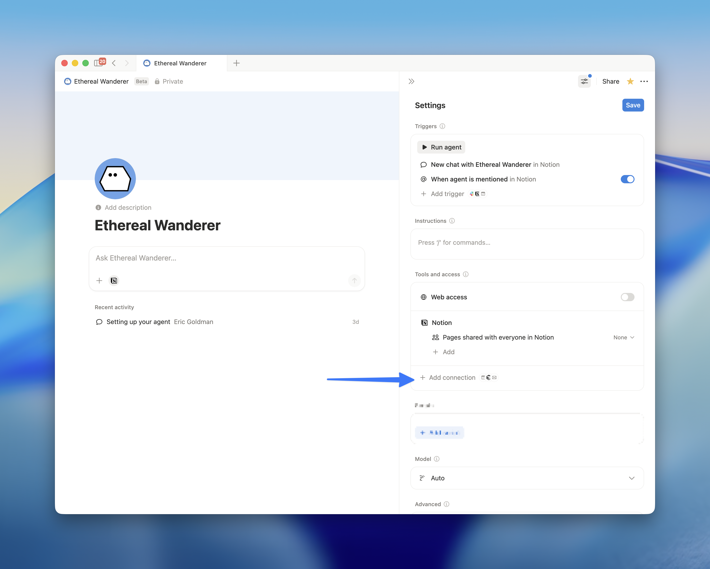

# Discogs → Notion Vinyl Collection Sync

A [Notion Worker](https://developers.notion.com) that mirrors your personal [Discogs](https://www.discogs.com) vinyl collection into a Notion database. Each row's page icon is set to the album cover, and useful metadata (artist, year, label, format, genres, rating, date added, etc.) is filled in for you.

The database is created in Notion as **Discog Vinyls (Worker)** and refreshed once an hour.



## What gets synced

Every release in your Discogs collection's "All" folder, with the following properties:

| Property | Type | Source |
|---|---|---|
| Album | Title | Release title |
| Artist | Text | Joined artist credits |
| Year | Number | Release year |
| Label | Text | Primary label |
| Catalog # | Text | Primary label catalog number |
| Format | Text | e.g. `Vinyl (LP, Album, Reissue)` |
| Genres | Text | Comma-joined |
| Styles | Text | Comma-joined |
| Rating | Number | Your 0–5 rating |
| Date Added | Date | When the release was added to your collection |
| Discogs URL | URL | Link to the release page |
| Cover | File | Album cover image |
| Instance ID | Text | Primary key (each copy gets its own row) |
| Release ID | Text | Discogs release ID |
| **Page icon** | — | Set to the album cover image |

The sync uses **replace mode**, so removing a release from Discogs deletes the corresponding row in Notion on the next run.

## Requirements

- [Node.js](https://nodejs.org) `>=22` and npm `>=10.9.2`
- A [Notion account](https://www.notion.so) with [Workers access](https://developers.notion.com/docs/workers) enabled
- A [Discogs account](https://www.discogs.com) with at least one release in your collection
- The `ntn` CLI (installed in the setup steps below)

## Setup

### 1. Clone and install

```shell
git clone https://github.com/<your-username>/discogs-notion-worker-sync.git
cd discogs-notion-worker-sync
npm install
```

### 2. Install the Notion `ntn` CLI and log in

```shell
curl -fsSL https://ntn.dev | bash
ntn login
```

`ntn login` connects the CLI to your Notion workspace. The deployed sync uses your workspace credentials to write to Notion — no separate Notion API token needed.

### 3. Get a Discogs personal access token

1. Go to <https://www.discogs.com/settings/developers>.
2. Click **Generate new token**.
3. Copy the token.

This is the only credential the worker needs. Your Discogs username is auto-detected from the token via `GET /oauth/identity` — no need to type it.

### 4. Add the token to `.env`

Open `.env` in the project root and paste your token:

```
DISCOGS_TOKEN=your_token_here
```

`.env` is gitignored, so the token never ends up in source control.

### 5. Create the worker, push secrets, deploy

```shell
ntn workers create --name discog-vinyls
ntn workers env push
ntn workers deploy
```

- `create` registers a new worker in your Notion workspace.
- `env push` uploads `.env` to the deployed worker so it can authenticate to Discogs.
- `deploy` builds the TypeScript and publishes the sync capability.

### 6. Trigger the first sync

```shell
ntn workers sync trigger collectionSync
```

This bypasses the 1-hour schedule and runs immediately. Watch progress with:

```shell
ntn workers sync status collectionSync
```

When it shows `HEALTHY`, open Notion — the **Discog Vinyls (Worker)** database will be in your workspace, populated with your collection.

## Day-to-day usage

The sync runs automatically every hour. You don't need to do anything to keep it up to date. Useful commands:

```shell
ntn workers sync status                   # live overview of all syncs
ntn workers sync trigger collectionSync   # force a sync now
ntn workers runs list                     # recent run history
```

### Preview without writing

To inspect what the sync would produce without touching the database:

```shell
ntn workers sync trigger collectionSync --preview
```

### View logs for the most recent run

```shell
ntn workers runs list --plain | grep collectionSync | head -n1 | cut -f1 | xargs -I{} ntn workers runs logs {}
```

### Reset and re-sync from scratch

```shell
ntn workers sync state reset collectionSync
ntn workers sync trigger collectionSync
```

### Rotate the Discogs token

1. Generate a new token at <https://www.discogs.com/settings/developers>.
2. Update `DISCOGS_TOKEN` in `.env`.
3. Push the new value:
   ```shell
   ntn workers env push
   ```
4. Revoke the old token in Discogs.

## How it works

`src/index.ts` declares one managed Notion database and one sync:

- **Pacer** — caps requests to Discogs at 50/min (their authenticated limit is 60/min; the buffer leaves headroom for retries).
- **Database** — `worker.database("vinylCollection", ...)` declares the Notion target. Because it's a *managed* database, the worker runtime handles all writes using your `ntn login` credentials.
- **Sync** — paginates `/users/{username}/collection/folders/0/releases?per_page=100` until exhausted, mapping each release to a row. The `instance_id` is used as the primary key so duplicate copies of the same release each get their own row.
- **Username lookup** — `GET /oauth/identity` resolves the username from the token and the result is cached in memory for the rest of the process.
- **Cover image as icon** — `Builder.imageIcon(cover_image)` sets each Notion page's icon to the album cover.

Sync schedule is `"1h"`. Change the `schedule` field in `src/index.ts` and re-deploy if you want it more or less frequent (`"5m"` to `"1d"` are valid).

## Development

```shell
npm run check   # type-check (no emit)
npm run build   # compile TypeScript to dist/
```

## Troubleshooting

**Sync status shows ERROR / WARNING** — check the latest run logs:
```shell
ntn workers runs list --plain | grep collectionSync | head -n1 | cut -f1 | xargs -I{} ntn workers runs logs {}
```

**`DISCOGS_TOKEN is not set`** — you forgot to `ntn workers env push` after editing `.env`. The local `.env` is only used for `--local` runs; the deployed worker reads from its own remote env.

**`401 Unauthorized` from Discogs** — the token is wrong, was revoked, or has trailing whitespace. Test it directly:
```shell
curl -H "Authorization: Discogs token=$DISCOGS_TOKEN" -H "User-Agent: test/1.0" https://api.discogs.com/oauth/identity
```

**Database name didn't update** — `initialTitle` only applies the first time the database is created. If you renamed it in code after first deploy, rename it manually in Notion (or delete the database and re-deploy).

**Some rows have a generic placeholder cover** — Discogs occasionally returns releases without a `cover_image`. The worker falls back to a default placeholder for those.

## License

MIT
